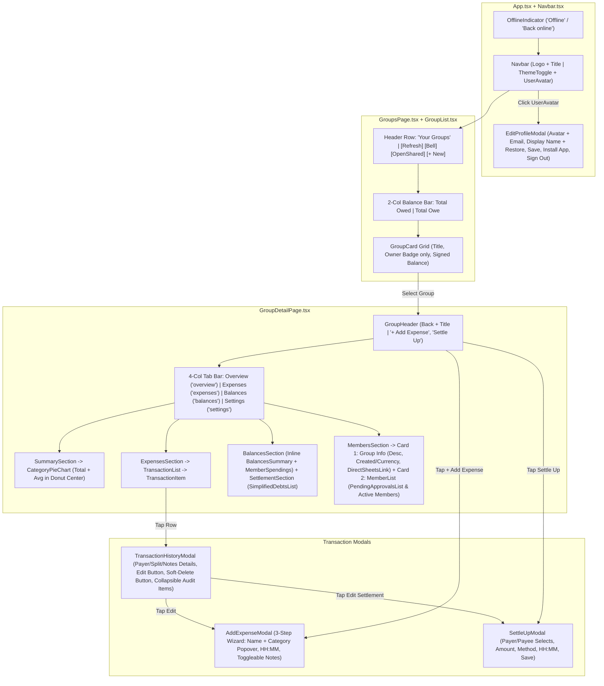

# Minimalist UI Overhaul

*   **Author:** zz
*   **Status:** Approved
*   **Date:** 2026-10-24

---

## Overview

Spread-Spends is a mobile-first progressive web application (PWA) for group expense splitting backed by Google Sheets. While the core financial logic and synchronization work reliably, the user interface is overloaded with explanatory subtitles, marketing callouts inside functional views, duplicate action buttons, and multi-line transaction metadata. On narrow mobile viewports such as the Google Pixel 9 (412×924 CSS pixels), this verbosity causes horizontal overflow, text truncation, and excessive vertical scrolling.

This design overhauls all 15 screens and modals of Spread-Spends into a minimalist interface that displays only essential data and controls, consolidates secondary actions into appropriate settings/profile containers, removes runtime developer/debug configuration from production screens, and ensures every view fits cleanly within a 412px mobile viewport.

## The Problem

1. **Pervasive Subtext & Marketing Clutter**: Nearly every page header, section card, and modal includes 1–3 sentences explaining what a button or screen does (e.g., `"Spreadsheets detected in your Google Drive..."`, `"Optimized to clear all balances in the fewest possible payments"`, `"Why Google Sheets?"`, `"Raw Google Spreadsheet Access"`, `"0ms Local Sync"`). Users who are already inside the app do not need marketing copy or instructions for self-explanatory titles.
2. **Mobile Horizontal Overflow & Clipping on 412px Screens**:
   - In `GroupHeader`, five horizontal buttons (`+ Add Expense`, `Settle Up`, `Invite`, `Sheet`, `Notify`) overflow off the right edge of a Pixel 9 viewport, clipping `Notify`.
   - In `GroupHeader`, the four tab labels (`Overview`, `Expenses`, `Balances & Settle`, `Members`) overflow horizontally, clipping `Members` to `Memb`.
   - In `AddExpenseModal` Step 3, placing the `"Split method"` label on the same row as the four split tabs (`Equally`, `Exact`, `Percentage`, `Shares`) wraps the label onto two lines and clips `# Shares`.
   - In `GroupCard`, `"Shared with you • Google Sheet"` wraps onto multiple lines and truncates.
3. **Redundant Data Duplication Across Views**:
   - The `Overview` tab repeats `Total Spending` and `Top Category` in standalone metric cards directly above a Donut Chart and Category list that display the exact same figures, and repeats `Recent Expenses` right next to the `Expenses` tab.
   - `BalancesSummary` hides other group members behind an extra popup modal when there is already a dedicated `Balances` tab.
   - `SettleUpModal` renders a `Payer pays → Recipient` preview card directly below the `Who paid?` and `Paid to whom?` dropdowns.
   - `AddExpenseModal` Step 3 renders a full `"NET IMPACT FOR THIS EXPENSE"` table below the split inputs.
4. **Crowded Transaction Feed Rows**: Each row in the `Expenses` tab renders `HH:MM:SS` timestamps, payer text, `Edited (n)` badges, `"You lent"` / `"You owe"` text labels, and three inline action icons (`Edit`, `Delete`, `History`), cramping the layout when tapping the row already opens the transaction detail/history modal.
5. **Production Exposure of Developer / Debug Controls**: `LoginScreen` exposes a collapsible `Google OAuth Client ID` input in production builds, and `NotificationSettingsModal` exposes a `"Send Test Notification"` button and `"Verify subscriptions in KV (debug)"` link.

## Goals

*   **Zero Explanatory Subtext**: Eliminate all descriptive subtitles under page titles, card headers, modal headers, and form inputs across all 15 screens and modals.
*   **Zero Horizontal Clipping on 412px Mobile Viewports**: Ensure the `Navbar`, `GroupList` header, `GroupHeader` actions, 4-tab navigation bar (`Overview | Expenses | Balances | Settings`), `GroupCard`, `TransactionItem`, `SimplifiedDebtsList`, and `AddExpenseModal` Step 3 split selector fit within a 412px width without horizontal overflow.
*   **Consolidated Navigation & Account Controls**:
    *   Keep only `ThemeToggle` and `UserAvatar` in the top-right `Navbar`; move `Install App` and `Sign Out` into `EditProfileModal`.
    *   Keep only `+ Add Expense` and `Settle Up` in `GroupHeader`; move Group Description, Created Date, Currency, and `"Open in Google Sheets"` into Card 1 of the renamed `Settings` tab (`settings` route key, formerly `members`).
*   **Streamlined Data Density**:
    *   Make `CategoryPieChart` (with `Avg` expense displayed inside the donut center) the sole component on the `Overview` tab.
    *   Display all member balances inline on the `Balances` tab without a secondary popup modal.
    *   Strip `TransactionItem` rows down to `CategoryIcon`, `Name`, and short `Date` on the left, and either `Total Amount + Signed User Delta` (or `"Settled"` when involved with zero net delta) or `"You are not involved"` (without total amount, when uninvolved) on the right; move `Edit` and soft-delete `Delete` exclusively into `TransactionHistoryModal` with full payer/split/notes details and default-collapsed `
` audit entries.
*   **Environment-Only Auth & Clean Production Modals**: Remove runtime OAuth Client ID state/storage from `LoginScreen` and `googleAuth.ts` (logging a `console.error` when `VITE_GOOGLE_CLIENT_ID` is missing), default new groups to `INR`, and strip debug actions from `NotificationSettingsModal`.

## Non-Goals

*   Modifying the underlying Google Sheets tab structure, column layout, or spreadsheet formulas.
*   Changing Cloudflare Worker push notification endpoints or KV storage schemas.
*   Altering the 3-step sequence (`Amount` → `Who Paid` → `Who Owes`) of `AddExpenseModal` or the mathematical split/debt simplification algorithms.

## Open Questions

*   None.

## Critical User Journeys (CUJs)

### CUJ 1: Signing In & Managing Account Options

*   **Given**: A user opens Spread-Spends on a 412px mobile browser with `VITE_GOOGLE_CLIENT_ID` configured in the environment.
*   **When**: The user views `LoginScreen`, signs in with Google, and taps their `UserAvatar` in the top-right `Navbar`.
*   **Then**:
    *   `LoginScreen` displays only the logo, `"Spread-Spends"`, `"Sign in with Google"`, and `"Install App"` (no subtitle, no `"Why Google Sheets?"` box, and no OAuth Client ID input; if `VITE_GOOGLE_CLIENT_ID` is missing, an error is logged via `console.error`).
    *   After login, `Navbar` shows only the brand on the left and `ThemeToggle` + `UserAvatar` on the right.
    *   Tapping `UserAvatar` opens `EditProfileModal` containing `[Avatar] email`, the `Display Name` input with inline `Restore`, `Save`, `Install App` (if not standalone), and `Sign Out`.

### CUJ 2: Browsing & Creating Groups on Home Screen

*   **Given**: An authenticated user lands on the `Your Groups` home screen (`GroupsPage` / `GroupList`).
*   **When**: The user views their groups and taps `+ New` to open `CreateGroupModal`.
*   **Then**:
    *   The `Your Groups` title sits on a single row alongside 3 icon-only buttons (`Refresh`, `Notifications`, `Open Shared`) and a `"+ New"` pill button, with no subtitle below.
    *   `Total You Are Owed` and `Total You Owe` render side-by-side in a 2-column grid on mobile (`grid-cols-2`), and the `Active Settlements` section is absent.
    *   Each `GroupCard` displays the group title, an `"Owner"` badge only if owned by the user (no green table icon, no `"Shared with you"` badge, no `"• Google Sheet"` text), and the signed colored net balance (`+₹X`, `-₹Y`, or `"Settled up"` when zero, without `"YOU ARE OWED"` / `"YOU OWE"` labels).
    *   `CreateGroupModal` shows only `Group Name` and `Default Currency` (defaulting to `INR`) with a `"Create"` submit button.

### CUJ 3: Adding an Expense via the Compact 3-Step Wizard

*   **Given**: A user is inside a group and taps `+ Add Expense` in `GroupHeader`.
*   **When**: The user fills out Step 1 (`Amount`), Step 2 (`Who Paid`), and Step 3 (`Who Owes`) in `AddExpenseModal`.
*   **Then**:
    *   Step 1 displays the hero Amount input, a `Name` input with an adjacent `CategoryIcon` button that opens a floating category popover when clicked, `Date` and `Time` (`HH:MM` without seconds), a `+ Add note` toggle button, and a `"Who Paid ->"` button.
    *   Step 2 lists member names without email addresses or helper text, omits `"Exact match! All payments accounted for."` in multi-payer mode, and has a `"Who Owes ->"` button.
    *   Step 3 renders `Equally | Exact | Percentage | Shares` as a full-width 4-column bar without a `"Split method"` label and without the `"NET IMPACT FOR THIS EXPENSE"` preview box.

### CUJ 4: Inspecting, Editing, and Soft-Deleting Transactions

*   **Given**: A user navigates to the `Expenses` tab of a group.
*   **When**: The user scans the transaction list and taps an expense row to open `TransactionHistoryModal`.
*   **Then**:
    *   Each expense row shows only `CategoryIcon`, `Name`, and short `Date` on the left (no `HH:MM:SS`, no payer text, no `Edited (n)` badge, and no inline `Edit`/`Delete`/`History` icons). On the right, if the user is involved (`userPaid > 0.005 || userOwed > 0.005`), it shows the total expense amount and the signed colored user delta (`+₹X` in green, `-₹Y` in red, or `"Settled"` in muted slate when net is zero); if not involved, it hides the total amount and shows only `"You are not involved"`.
    *   Each settlement row shows `HandCoins`, `[PayerAvatar] paid [PayeeAvatar]` (avatars only, without member names), `Date • Method` on the left, and the settlement amount on the right.
    *   Tapping any row opens `TransactionHistoryModal`, which displays the transaction's payer/split/notes details, a single `Edit` button, a confirmation-guarded soft-delete `Delete` button (marking `status = 'DELETED'` in the Google Sheet and updating active filter counts), and native `
` audit trail entries that are collapsed by default (showing only editor avatar, name, and timestamp) and expand on click to show field diffs.

### CUJ 5: Viewing Group Overview, Inline Balances, and Group Settings

*   **Given**: A user switches across `Overview`, `Balances`, and `Settings` in `GroupHeader`.
*   **When**: Each tab renders on a 412px mobile screen.
*   **Then**:
    *   `Overview` renders only `CategoryPieChart` with `Avg ₹X` inside the donut center below Total Spending (no description banner, no 3 metric cards, no `Recent Expenses`).
    *   `Balances` renders all members inline inside `Member Balances` (showing `+₹X`, `-₹Y`, or `"Settled"` without a popup modal or `"You get back"` / `"Owes"` sub-labels), `Spending & Consumption` bars without repeated `"Paid"` / `"Consumed"` labels above each bar, and single-line `Suggested Settlements` rows (`[FromAvatar] Name → [ToAvatar] Name` with truncation, amount, and `"Settle"` button).
    *   `Settings` (route key `'settings'`) renders Card 1 (`Group Info` with editable description, `Created [Date] • Currency: [INR]`, and compact `<DirectSheetsLink />` `"Open in Google Sheets"` button) and Card 2 (`Members` with pending invites and active members badging only `"Owner"`).

---

## Technical Plan (Architecture)

### 1. High-Level Component Reorganization & Control Consolidation

The UI architecture shifts secondary actions out of persistent headers/list rows and into contextual modals or the dedicated `Settings` tab, while eliminating redundant intermediate modals (`BalancesSummary` popup) and duplicate dashboard widgets.

### 2. Core Architectural Changes

#### A. Environment-Only Google OAuth Configuration ([`googleAuth.ts`](file:///home/zz/Projects/Spread-Spends/src/services/googleAuth.ts), [`useAuth.ts`](file:///home/zz/Projects/Spread-Spends/src/hooks/useAuth.ts), [`LoginScreen.tsx`](file:///home/zz/Projects/Spread-Spends/src/components/auth/LoginScreen.tsx))
*   **Current State**: `googleAuthService.getClientId()` checks `localStorage.getItem('spread_spends_google_client_id')` before falling back to `import.meta.env.VITE_GOOGLE_CLIENT_ID`, and [`LoginScreen.tsx`](file:///home/zz/Projects/Spread-Spends/src/components/auth/LoginScreen.tsx) renders a collapsible form to edit and save a custom Client ID in browser storage.
*   **Target Architecture**:
    *   `googleAuthService.getClientId()` reads `import.meta.env.VITE_GOOGLE_CLIENT_ID || ''` directly. If empty (and not in demo mode), `initClient()` and `requestLogin()` log `console.error('[Spread-Spends] Missing VITE_GOOGLE_CLIENT_ID environment variable. Provide VITE_GOOGLE_CLIENT_ID in your .env file.')` and throw a clean error on login attempt.
    *   `LoginScreenProps` drops `clientId` and `onSaveClientId` (or marks them unused optional props for backward test compatibility), removing all Client ID state, form inputs, `"Why Google Sheets?"` marketing cards, and subtitles from [`LoginScreen.tsx`](file:///home/zz/Projects/Spread-Spends/src/components/auth/LoginScreen.tsx).

#### B. Top Navbar & Account Modal Consolidation ([`App.tsx`](file:///home/zz/Projects/Spread-Spends/src/App.tsx), [`Navbar.tsx`](file:///home/zz/Projects/Spread-Spends/src/components/common/Navbar.tsx), [`EditProfileModal.tsx`](file:///home/zz/Projects/Spread-Spends/src/components/auth/EditProfileModal.tsx))
*   **Navbar**: Renders only the brand mark (`Table` icon + `"Spread-Spends"`) on the left and `ThemeToggle` + `UserAvatar` button on the right (when signed in). The `Install App` button, user name text, `"Edit user name"` label, and `LogOut` icon button are removed from [`Navbar.tsx`](file:///home/zz/Projects/Spread-Spends/src/components/common/Navbar.tsx).
*   **EditProfileModal**: Expanded to act as the unified Account & Profile modal. `EditProfileModalProps` accepts `onLogout?: () => void`, `showInstallButton?: boolean`, and `onOpenInstall?: () => void`. Below the compact `[Avatar] email` header and `Display Name` form (with inline `Restore` button and `"Save"` submit button), a footer row provides `"Install App"` (when `showInstallButton` is true) and `"Sign Out"`.

#### C. Route & Swipeable Tab Key Migration (`members` → `settings`)
*   **Tab Union Update**: In [`useSwipeableTabs.ts`](file:///home/zz/Projects/Spread-Spends/src/hooks/useSwipeableTabs.ts), `GROUP_TABS` is updated from `['overview', 'expenses', 'balances', 'members'] as const` to `['overview', 'expenses', 'balances', 'settings'] as const`.
*   **Router & Section Mapping**:
    *   [`useAppRoute.ts`](file:///home/zz/Projects/Spread-Spends/src/router/useAppRoute.ts) imports `GROUP_TABS` from `../hooks/useSwipeableTabs`, maps legacy `tab=members` to `'settings'`, and validates `tab` against `GROUP_TABS` (falling back to `'overview'` for any unrecognized tab value).
    *   [`GroupHeader.tsx`](file:///home/zz/Projects/Spread-Spends/src/components/groups/GroupHeader.tsx) and [`groupSections.tsx`](file:///home/zz/Projects/Spread-Spends/src/pages/group/groupSections.tsx) map `'balances'` to label `'Balances'` and `'settings'` to label `'Settings'` (using the `Settings` icon from `lucide-react`) while preserving the pending-approvals badge on `'settings'`.

#### D. Group Overview Reduction & Group Settings Consolidation ([`SummarySection.tsx`](file:///home/zz/Projects/Spread-Spends/src/pages/group/summary/SummarySection.tsx), [`CategoryPieChart.tsx`](file:///home/zz/Projects/Spread-Spends/src/pages/group/summary/CategoryPieChart.tsx), [`MembersSection.tsx`](file:///home/zz/Projects/Spread-Spends/src/pages/group/members/MembersSection.tsx), [`DirectSheetsLink.tsx`](file:///home/zz/Projects/Spread-Spends/src/components/export/DirectSheetsLink.tsx))
*   **Overview Tab ([`SummarySection.tsx`](file:///home/zz/Projects/Spread-Spends/src/pages/group/summary/SummarySection.tsx) & [`CategoryPieChart.tsx`](file:///home/zz/Projects/Spread-Spends/src/pages/group/summary/CategoryPieChart.tsx))**:
    *   [`SummarySection.tsx`](file:///home/zz/Projects/Spread-Spends/src/pages/group/summary/SummarySection.tsx) removes the Group Overview description banner, the 3 metric cards (`Total Spending`, `Top Category`, `Avg Expense`), and the `Recent Expenses` card. It renders `<CategoryPieChart />` directly.
    *   [`CategoryPieChart.tsx`](file:///home/zz/Projects/Spread-Spends/src/pages/group/summary/CategoryPieChart.tsx) removes the `"X categories • Y expenses"` header count and `"Tap or hover over a slice to inspect details"` helper text. In the default (unhovered) state of the SVG donut center, it displays:
        1. `Total Spending` label
        2. `{formatCurrency(totalSpend, currency)}`
        3. `Avg {formatCurrency(avgExpense, currency)}` (where `avgExpense = activeExpenses.length > 0 ? totalSpend / activeExpenses.length : 0`).
*   **Settings Tab ([`MembersSection.tsx`](file:///home/zz/Projects/Spread-Spends/src/pages/group/members/MembersSection.tsx), [`MemberList.tsx`](file:///home/zz/Projects/Spread-Spends/src/pages/group/members/MemberList.tsx), [`PendingApprovalsList.tsx`](file:///home/zz/Projects/Spread-Spends/src/pages/group/members/PendingApprovalsList.tsx))**:
    *   **Card 1 (`Group Info`)**: Houses the editable group description state (`isEditingDescription`, `descriptionInput`, `handleSaveDescription` migrated from [`SummarySection.tsx`](file:///home/zz/Projects/Spread-Spends/src/pages/group/summary/SummarySection.tsx)), a single metadata line (`Created {formattedDate} • Currency: {currency}`), and the simplified `<DirectSheetsLink group={group} />` component (which renders a clean `"Open in Google Sheets"` anchor button when `group.driveFileUrl` is present, without the `"Raw Google Spreadsheet Access"` marketing card). Push notification settings remain accessible via the Home screen Bell button, and unused `Invite`/`Sheet`/`Notify` props and icons are removed from [`GroupHeader.tsx`](file:///home/zz/Projects/Spread-Spends/src/components/groups/GroupHeader.tsx).
    *   **Card 2 (`Members`)**: Rendered via [`MemberList.tsx`](file:///home/zz/Projects/Spread-Spends/src/pages/group/members/MemberList.tsx), which encapsulates [`PendingApprovalsList.tsx`](file:///home/zz/Projects/Spread-Spends/src/pages/group/members/PendingApprovalsList.tsx) (with its explanatory paragraph removed) and the `Active Members` card (with its `"People with edit permissions on this group Google Sheet."` subtitle removed, and only rendering `<Badge variant="emerald">Owner</Badge>` when `m.role === 'OWNER'`—omitting the `"Member"` badge on non-owners).

#### E. Transaction Feed & Soft-Delete Lifecycle ([`TransactionList.tsx`](file:///home/zz/Projects/Spread-Spends/src/pages/group/expenses/TransactionList.tsx), [`TransactionItem.tsx`](file:///home/zz/Projects/Spread-Spends/src/pages/group/expenses/TransactionItem.tsx), [`TransactionHistoryModal.tsx`](file:///home/zz/Projects/Spread-Spends/src/pages/group/expenses/TransactionHistoryModal.tsx), [`GroupDetailPage.tsx`](file:///home/zz/Projects/Spread-Spends/src/pages/group/GroupDetailPage.tsx))
*   **Active Filter Counts**: In [`TransactionList.tsx`](file:///home/zz/Projects/Spread-Spends/src/pages/group/expenses/TransactionList.tsx), filter counts are computed from active records (`activeExpenses = expenses.filter(e => e.status !== 'DELETED')`, `activeSettlements = settlements.filter(s => s.status !== 'DELETED')`) so soft-deleted transactions do not inflate the `All`, `Expenses`, or `Settlements` filter tab numbers.
*   **Minimalist [`TransactionItem.tsx`](file:///home/zz/Projects/Spread-Spends/src/pages/group/expenses/TransactionItem.tsx)**:
    *   Removes all inline `Edit`, `Delete`, and `History` icon buttons and removes the amber `Edited (n)` badge. Clicking anywhere on the row triggers `onViewHistory(item)`.
    *   **Expense Row**: Left side displays `<CategoryIcon />`, `exp.description`, and `dt.date` (no `dt.time`, no `"X paid"` text). Right side checks `const isInvolved = userPaid > 0.005 || userOwed > 0.005`:
        *   If `isInvolved`: displays the total expense amount (`formatCurrency(exp.amount, currency)`) on top and either the signed colored user delta (`+{formatCurrency(userNet, currency)}` in emerald or `-{formatCurrency(Math.abs(userNet), currency)}` in rose when `Math.abs(userNet) > 0.005`) or `"Settled"` in muted slate (when `Math.abs(userNet) <= 0.005`) below, with no `"You lent"` / `"You borrowed"` words.
        *   If `!isInvolved`: hides `exp.amount` completely and displays only `"You are not involved"` in muted slate.
    *   **Settlement Row**: Left side displays `<HandCoins />`, `[PayerAvatar] paid [PayeeAvatar]` (avatar-only without member names, retaining `title` tooltips on each `UserAvatar`) on one line, and `{dt.date} • {s.paymentMethod}` below. Right side displays only `{formatCurrency(s.amount, currency)}`.
*   **[`TransactionHistoryModal.tsx`](file:///home/zz/Projects/Spread-Spends/src/pages/group/expenses/TransactionHistoryModal.tsx) Details, Soft-Delete, & Collapsible Audit Trail**:
    *   In the top summary card, renders compact read-only details for `Paid by` (`exp.paidBy`), `Split` (`exp.splits`), and `Notes` (`data.notes`, when present) so details removed from `TransactionItem` rows remain inspectable on tap.
    *   Adds `onDelete?: () => Promise<unknown> | void` to `TransactionHistoryModalProps`, wired in [`GroupDetailPage.tsx`](file:///home/zz/Projects/Spread-Spends/src/pages/group/GroupDetailPage.tsx) to invoke `deleteExpense({ expenseId, editorEmail })` or `deleteSettlement({ settlementId, editorEmail })` and call `setViewingHistoryTransaction(null)`. Clicking `"Delete"` prompts via `window.confirm`, awaits `onDelete()`, and calls `onClose()` without introducing React hook state (keeping `TransactionHistoryModal` callable directly as a plain function in unit tests).
    *   Removes the `"ACTIVE"` status badge, `"Newest modifications first"`, `"edited this transaction"`, the duplicate top `Edit` button, and the `record.summary` box.
    *   Each audit revision card uses native HTML `
` and `
` elements so entries start collapsed by default (showing only `[EditorAvatar] [displayName]`, `{formatDateTime(record.editedAt)}`, and a `ChevronDown` icon) and expand on click to reveal the `oldValue → newValue` field diffs without requiring React `useState` hooks.

#### F. Compact Modals & Form Controls ([`AddExpenseModal.tsx`](file:///home/zz/Projects/Spread-Spends/src/pages/group/expenses/AddExpenseModal.tsx), [`SettleUpModal.tsx`](file:///home/zz/Projects/Spread-Spends/src/pages/group/settlement/SettleUpModal.tsx), [`CreateGroupModal.tsx`](file:///home/zz/Projects/Spread-Spends/src/pages/groups/CreateGroupModal.tsx), [`OpenGroupModal.tsx`](file:///home/zz/Projects/Spread-Spends/src/pages/groups/OpenGroupModal.tsx), [`InviteMemberModal.tsx`](file:///home/zz/Projects/Spread-Spends/src/pages/group/members/InviteMemberModal.tsx), [`InstallAppModal.tsx`](file:///home/zz/Projects/Spread-Spends/src/components/pwa/InstallAppModal.tsx), [`NotificationSettingsModal.tsx`](file:///home/zz/Projects/Spread-Spends/src/components/notifications/NotificationSettingsModal.tsx))
*   **Time Format (`HH:MM`)**: `time` state initialization in [`AddExpenseModal.tsx`](file:///home/zz/Projects/Spread-Spends/src/pages/group/expenses/AddExpenseModal.tsx) and [`SettleUpModal.tsx`](file:///home/zz/Projects/Spread-Spends/src/pages/group/settlement/SettleUpModal.tsx) normalizes time strings via `extractTimeFromTimestamp(...).slice(0, 5)` to `"HH:MM"` (5 characters) and `<input type="time" />` omits `step="1"`, eliminating the seconds spinner.
*   **[`AddExpenseModal.tsx`](file:///home/zz/Projects/Spread-Spends/src/pages/group/expenses/AddExpenseModal.tsx)**:
    *   Stepper removes `subtitle` labels; Step 1 and Step 2 primary buttons read `"Who Paid ->"` and `"Who Owes ->"`.
    *   **Step 1**: Renames `"Description"` to `"Name"`. Places a `<button type="button" aria-label="Select category">` rendering `<CategoryIcon category={category} size="md" />` directly beside the `Name` input in a `relative flex items-center gap-2` row; clicking it opens an `absolute left-0 top-full mt-2 z-30` popover grid of the 8 categories (`isCategoryPopoverOpen` state, auto-closing on selection). Places the `Notes` input behind a `+ Add note` toggle button (auto-expanded if editing an expense that already has notes).
    *   **Step 2**: Removes `"Select who paid the full..."`, removes member email addresses under names, and removes `"Exact match! All payments accounted for."`.
    *   **Step 3**: Removes `"Split method"` label and renders `Equally | Exact | Percentage | Shares` in a full-width `grid-cols-4` segmented bar. Removes `"Select who shares..."` label (retaining the `"Select all" / "Deselect all"` button in a `flex justify-end` wrapper) and deletes the `"Net Impact for this Expense"` card.
*   **[`BalancesSummary.tsx`](file:///home/zz/Projects/Spread-Spends/src/pages/group/balances/BalancesSummary.tsx), [`MemberSpendings.tsx`](file:///home/zz/Projects/Spread-Spends/src/pages/group/balances/MemberSpendings.tsx), [`SimplifiedDebtsList.tsx`](file:///home/zz/Projects/Spread-Spends/src/pages/group/settlement/SimplifiedDebtsList.tsx)**:
    *   [`BalancesSummary.tsx`](file:///home/zz/Projects/Spread-Spends/src/pages/group/balances/BalancesSummary.tsx) renders all `orderedBalances` inline inside the card (deleting the `<Modal>` popup and its unused state/imports) and displays `+₹X`, `-₹Y`, or `"Settled"` (when zero), removing `"You get back"` / `"Gets back"` / `"You owe"` / `"Owes"` / `"All settled up"` sub-labels.
    *   [`MemberSpendings.tsx`](file:///home/zz/Projects/Spread-Spends/src/pages/group/balances/MemberSpendings.tsx) removes its subtitle (`"How much each member paid out of pocket versus consumed in expenses."`) and removes the repeated `"Paid"` and `"Consumed"` labels above each bar, right-aligning (`justify-end`) each bar's formatted amount and relying on the top `Paid` (green) / `Consumed` (blue) legend.
    *   [`SimplifiedDebtsList.tsx`](file:///home/zz/Projects/Spread-Spends/src/pages/group/settlement/SimplifiedDebtsList.tsx) removes its subtitle, drops the word `"owes"` (`[FromAvatar] Name → [ToAvatar] Name`), and lays out each debt item as a single horizontal flex row (`flex items-center justify-between gap-2`) with `min-w-0 flex-1 truncate` on the participant container and `shrink-0` on the amount + `"Settle"` button container.

---

## Alternatives Considered

### Alternative A: Keep Internal Tab Key `'members'` While Displaying Label `'Settings'`

*   **Pros**: Avoids touching `GROUP_TABS` in `useSwipeableTabs.ts`, hash URL parsing in `useAppRoute.ts`, and existing swipeable-tab test assertions that reference `'members'`.
*   **Cons**: Creates permanent naming drift between the route/state identifier (`tab === 'members'`) and the actual UI concept (`Settings` tab housing group description, creation metadata, spreadsheet link, and member management).
*   **Reason for Rejection**: Explicitly rejected in favor of migrating the key to `'settings'` across code and tests so route hashes (`#group=<id>&tab=settings`), types, and UI labels remain consistent.

### Alternative B: Render Full Member Names Alongside Avatars on Settlement Rows (`[PayerAvatar] Name paid [PayeeAvatar] Name`)

*   **Pros**: Displays full text names inline without requiring the user to recognize avatars or tap the row.
*   **Cons**: On a 412px mobile viewport, two full display names plus two avatars and the amount column cause long names to wrap onto multiple lines.
*   **Reason for Rejection**: Rejected in favor of avatar-only settlement rows (`[PayerAvatar] paid [PayeeAvatar]`) which keep every settlement item compact on a single horizontal line, while tapping the row still opens `TransactionHistoryModal` with full participant details.

### Alternative C: Hide Total Expense Amount on All Expense Feed Rows

*   **Pros**: Reduces the right-hand side of every expense card to a single number (`+₹94.61` or `-₹100.00`).
*   **Cons**: Users scanning the feed for a specific bill (e.g., a ₹1,200 dinner) cannot identify the total expense amount without tapping each row to open `TransactionHistoryModal`.
*   **Reason for Rejection**: Showing the total expense amount above the signed user delta *only* when the user is involved (and hiding the total amount while showing `"You are not involved"` when uninvolved) balances context for relevant expenses with low noise for irrelevant ones.

### Alternative D: Collapse the 3-Step Add Expense Wizard into a Single Long Scrolling Modal

*   **Pros**: Fewer clicks when creating a default equal-split expense.
*   **Cons**: Combining Amount, Category, Date/Time, Notes, Multi-Payer inputs, and 4 Split Method tabs into one scrolling modal on a 412×924 mobile screen creates a tall, cramped form especially when the virtual keyboard is open.
*   **Reason for Rejection**: Keeping the 3-step wizard (`Amount` → `Who Paid` → `Who Owes`) while stripping step subtitles, moving Category into a popover beside `Name`, hiding `Notes` behind `+ Add note`, and removing the `"NET IMPACT"` card keeps each step compact above the mobile keyboard.

---

## Non-Functional Requirements

*   **Mobile Viewport Ergonomics (412px Width)**: Every header bar, tab bar (`Overview | Expenses | Balances | Settings`), segmented control (`Equally | Exact | Percentage | Shares`), group card, and transaction item must render without unintended horizontal scrollbars or clipped buttons at `375px–412px` viewport widths.
*   **Data Integrity on Soft Delete**: Deleting an expense or settlement from `TransactionHistoryModal` must soft-delete the record (`status: 'DELETED'` persisted to the Google Sheet with an audit history entry) rather than physically removing the row from the spreadsheet, ensuring complete auditability in Google Sheets while excluding the item from UI feeds, filter counts, category charts, and balance/settlement calculations.
*   **Accessibility**: Icon-only buttons in `Navbar`, `GroupList` (`Refresh`, `Notifications`, `Open Shared`), and `AddExpenseModal` (the `CategoryIcon` popover trigger) must retain descriptive `aria-label` and `title` attributes so screen readers and automated test queries remain functional.

---

## Detailed Implementation Plan

### 1. Authentication, Shell, & PWA Components

*   **[Modify] [`./src/services/googleAuth.ts`](file:///home/zz/Projects/Spread-Spends/src/services/googleAuth.ts)**
    *   **Rationale**: Remove runtime browser storage overrides for the Google OAuth Client ID and enforce environment-driven configuration with developer console diagnostics.
    *   **Changes**:
        *   Remove the unused `CLIENT_ID_STORAGE_KEY` constant, update `setClientId()` to a no-op, and update `getClientId()` to return `(typeof import.meta !== 'undefined' && import.meta.env?.VITE_GOOGLE_CLIENT_ID) || ''` directly without reading `localStorage`.
        *   In `initClient()` and `requestLogin()`, when `!clientId && !this.isDemoMode`, call `console.error('[Spread-Spends] Missing VITE_GOOGLE_CLIENT_ID environment variable. Provide VITE_GOOGLE_CLIENT_ID in your .env file.')`.
*   **[Modify] [`./src/hooks/useAuth.ts`](file:///home/zz/Projects/Spread-Spends/src/hooks/useAuth.ts)**
    *   **Rationale**: Align authentication hook callbacks with environment-only Client ID handling while keeping `App.tsx` call sites intact.
    *   **Changes**: Make `setCustomClientId` a no-op callback and keep `getCustomClientId` returning `googleAuthService.getClientId()`.
*   **[Modify] [`./src/components/auth/LoginScreen.tsx`](file:///home/zz/Projects/Spread-Spends/src/components/auth/LoginScreen.tsx)**
    *   **Rationale**: Strip marketing bloat, explanatory subtitles, and the OAuth Client ID configuration form from the login screen.
    *   **Changes**:
        *   Keep `clientId?: string` and `onSaveClientId?: (id: string) => void` as optional properties on `LoginScreenProps` (for caller compatibility) without destructuring them in `LoginScreen`.
        *   Remove the subtitle paragraph (`"Expense sharing powered natively by your Google Sheets"`) below `"Spread-Spends"`.
        *   Remove `"Sign in with your Google account to create and access your group spreadsheets."` below the sign-in button.
        *   Shorten the PWA install button label from `"Install app for offline viewing"` to `"Install App"`.
        *   Delete the `"Why Google Sheets?"` 3-item card and delete the collapsible `"Google OAuth Client ID"` configuration block (`showConfig`, `clientIdInput`, `savedSuccess`, `handleSave`).
        *   Remove unused imports `useState` (from `'react'`), `Key`, `CheckCircle2`, `ShieldCheck`, `ExternalLink`, `ArrowRight` (from `'lucide-react'`), and `Button` (from `'../common/Button'`).
*   **[Modify] [`./src/components/common/Navbar.tsx`](file:///home/zz/Projects/Spread-Spends/src/components/common/Navbar.tsx)**
    *   **Rationale**: Declutter the top navigation bar on 412px mobile screens by keeping only the brand logo/title on the left and `ThemeToggle` + `UserAvatar` on the right.
    *   **Changes**:
        *   Delete the `
` subtitle `"Expense sharing powered by your Google Sheets"` under `"Spread-Spends"`.
        *   Remove the `"Install App"` button, the user name/subtitle text block (`{user.name}` / `"Edit user name"`), and the `LogOut` icon button from `Navbar` (removing unused imports `LogOut`, `Download`, `Pencil`, `Button` and unused destructured props `onLogout`, `showInstallButton`, `onOpenInstall` while keeping them optional on `NavbarProps`).
        *   Render `<ThemeToggle />` and the `<button onClick={onOpenEditProfile} aria-label="Edit user profile"><UserAvatar ... /></button>` in the right-hand actions container.
*   **[Modify] [`./src/components/auth/EditProfileModal.tsx`](file:///home/zz/Projects/Spread-Spends/src/components/auth/EditProfileModal.tsx)**
    *   **Rationale**: Consolidate account actions (`Install App`, `Sign Out`, `Display Name` editing) into a single compact modal triggered by tapping `UserAvatar` in the `Navbar`.
    *   **Changes**:
        *   Extend `EditProfileModalProps` with `onLogout?: () => void`, `showInstallButton?: boolean`, and `onOpenInstall?: () => void`.
        *   Remove the `"Google Account Photo"` badge, `"Profile picture is set to your connected Google account."`, and `"This name will be shown on expense splits, shared groups, and settlement receipts."`, and remove unused `Sparkles` import (adding `Download` and `LogOut` from `'lucide-react'`).
        *   Render `[UserAvatar] {user.email}` on one compact line, followed by the `Display Name` input with an inline `"Restore"` button (when `isCustomName` is true).
        *   Shorten the primary submit button from `"Save Changes"` to `"Save"`.
        *   Add a bottom actions section containing `"Install App"` (when `showInstallButton && onOpenInstall`) and `"Sign Out"` (calling `onClose()` and `onLogout()`).
*   **[Modify] [`./src/App.tsx`](file:///home/zz/Projects/Spread-Spends/src/App.tsx)**
    *   **Rationale**: Wire `logout`, `!isStandalone`, and `openInstallModal` into `EditProfileModal`.
    *   **Changes**: Pass `onLogout={logout}`, `showInstallButton={!isStandalone}`, and `onOpenInstall={() => { setIsEditProfileOpen(false); openInstallModal(); }}` to `<EditProfileModal />`.
*   **[Modify] [`./src/components/pwa/OfflineIndicator.tsx`](file:///home/zz/Projects/Spread-Spends/src/components/pwa/OfflineIndicator.tsx)**
    *   **Rationale**: Replace multi-clause status banners with terse status indicators.
    *   **Changes**: Replace `"Back online — ready to sync with Google Sheets."` with `"Back online"`, and replace `"Offline Mode — viewing cached groups, expenses, and balances."` with `"Offline"`.
*   **[Modify] [`./src/components/pwa/InstallAppModal.tsx`](file:///home/zz/Projects/Spread-Spends/src/components/pwa/InstallAppModal.tsx)**
    *   **Rationale**: Strip promotional perk cards and redundant headers/footers from the installation guide modal.
    *   **Changes**:
        *   Remove the 3 perk cards (`100% Offline`, `Instant Load`, `Auto Sync`), the `"One-Tap Install Ready"` description paragraph, the `"How to install on Android Chrome / Edge / Firefox"` and `"How to install on iPhone & iPad (Safari)"` headings, the bottom `"Once installed, launch Spread-Spends directly from your home screen for full offline viewing."` box, and the footer button (`Maybe later` / `Got it`), removing unused `WifiOff`, `Zap`, and `CheckCircle2` imports.
        *   Keep only the `Android | iOS (Safari)` segmented switcher and the 3 numbered installation steps (or the 1-tap `"Install Spread-Spends Now"` button when native prompt is available).

### 2. Home Screen & Group Creation Modals

*   **[Modify] [`./src/components/groups/GroupList.tsx`](file:///home/zz/Projects/Spread-Spends/src/components/groups/GroupList.tsx)**
    *   **Rationale**: Fit header controls onto a single row with `"Your Groups"`, compact the balance cards into 2 columns on mobile, and remove the duplicate `Active Settlements` list from the home page.
    *   **Changes**:
        *   Delete the `"Spreadsheets detected in your Google Drive..."` subtitle.
        *   Place `"Your Groups"` and the action toolbar in a single horizontal flex row (`flex items-center justify-between gap-2`): render `Refresh`, `Notifications`, and `Open Shared` as compact icon-only buttons (`p-2`, retaining `title` and `aria-label`) followed by a `"+ New"` pill button.
        *   Change the `Total You Are Owed` / `Total You Owe` container from `grid-cols-1 sm:grid-cols-2` to `grid-cols-2 gap-3`.
        *   Remove the `"Active Settlements"` section from `GroupList.tsx`, removing unused imports `HandCoins` and `UserAvatar` and removing `activeSettlements` and `onSettleDebt` from the destructured props (while keeping them optional on `GroupListProps`).
*   **[Modify] [`./src/pages/groups/GroupCard.tsx`](file:///home/zz/Projects/Spread-Spends/src/pages/groups/GroupCard.tsx)**
    *   **Rationale**: Eliminate redundant icons, `"Shared with you • Google Sheet"` subtext, and `"YOU ARE OWED"` / `"YOU OWE"` labels from group cards.
    *   **Changes**:
        *   Import `Badge` from `../../components/common/Badge` and remove unused `Table`, `UserCheck`, and `Shield` imports from `'lucide-react'`.
        *   Remove the green `Table` icon box (`w-11 h-11`).
        *   Remove `"• Google Sheet"` and the `"Shared with you"` badge; render `<Badge variant="emerald">Owner</Badge>` only when `isOwner` is true.
        *   In the right-hand balance column, delete the `"YOU ARE OWED"` and `"YOU OWE"` text spans above the amount so only `+₹X` (in emerald), `-₹Y` (in rose), or `"Settled up"` is rendered.
*   **[Modify] [`./src/pages/groups/CreateGroupModal.tsx`](file:///home/zz/Projects/Spread-Spends/src/pages/groups/CreateGroupModal.tsx)**
    *   **Rationale**: Simplify group creation to just `Group Name` and `Default Currency` (defaulting to `INR`).
    *   **Changes**:
        *   Change initial `currency` state from `'USD'` to `'INR'` (and update the reset inside `handleSubmit` to `setCurrency('INR')`).
        *   Remove the `Description` input and the `Invite Members` input/chip list (`onCreateGroup` passes `[]` for `memberEmails` and `undefined` for `description`), and remove unused imports `Plus`, `X`, `Users` and unused locals `description`, `setDescription`, `memberEmailInput`, `setMemberEmailInput`, `memberEmails`, `setMemberEmails`, `handleAddMember`, `handleRemoveMember`.
        *   Shorten the submit button label from `"Create Group Sheet"` to `"Create"`.
*   **[Modify] [`./src/pages/groups/OpenGroupModal.tsx`](file:///home/zz/Projects/Spread-Spends/src/pages/groups/OpenGroupModal.tsx)**
    *   **Rationale**: Strip technical OAuth scope explanations (`drive.file`) and instructions from the shared sheet modal.
    *   **Changes**:
        *   Remove the top `drive.file` `
` explanation paragraph, the `"Pick any shared spreadsheet from your Drive."` subtext, and the `"Paste a link shared with you..."` helper text.
        *   Retain only the `"Pick from Drive"` button, the `"OR"` divider, and the `"Spreadsheet Link or ID"` input + `"Open"` button.

### 3. Group Header, Navigation Tabs, Overview, & Settings Tab

*   **[Modify] [`./src/hooks/useSwipeableTabs.ts`](file:///home/zz/Projects/Spread-Spends/src/hooks/useSwipeableTabs.ts)**
    *   **Rationale**: Rename the 4th group tab key from `'members'` to `'settings'`.
    *   **Changes**: Update `GROUP_TABS` to `['overview', 'expenses', 'balances', 'settings'] as const`.
*   **[Modify] [`./src/router/useAppRoute.ts`](file:///home/zz/Projects/Spread-Spends/src/router/useAppRoute.ts)**
    *   **Rationale**: Support `#group=<id>&tab=settings` in URL hash routing while preventing blank renders on legacy `tab=members` or invalid tab strings.
    *   **Changes**: Import `GROUP_TABS` from `../hooks/useSwipeableTabs` in `parseHash`, map `rawTab === 'members'` to `'settings'`, and validate against `GROUP_TABS` (falling back to `'overview'` if unrecognized).
*   **[Modify] [`./src/pages/group/groupSections.tsx`](file:///home/zz/Projects/Spread-Spends/src/pages/group/groupSections.tsx)**
    *   **Rationale**: Update section registry labels and icons to match `Overview | Expenses | Balances | Settings`.
    *   **Changes**: Replace `Users` with `Settings` in the `'lucide-react'` import, change the `'balances'` section label from `'Balances & Settle'` to `'Balances'`, and change the 4th section entry from `id: 'members', label: 'Members', icon: Users` to `id: 'settings', label: 'Settings', icon: Settings` (rendering `<MembersSection />`).
*   **[Modify] [`./src/components/groups/GroupHeader.tsx`](file:///home/zz/Projects/Spread-Spends/src/components/groups/GroupHeader.tsx)**
    *   **Rationale**: Fix horizontal button clipping and tab bar overflow on 412px mobile screens.
    *   **Changes**:
        *   Remove the `"You own this sheet"` / `"Shared Group"` badge and the `"Currency: X • Y active members"` subtitle (and remove unused `const currency = ...`).
        *   In the header action bar, keep only `+ Add Expense` and `Settle Up` (removing `Invite`, `Sheet`, and `Notify` buttons, removing unused destructured props `financialSummary`, `onOpenInvite`, `isPushEnabled`, `onToggleNotifications`, `onOpenNotificationSettings`, and replacing `ExternalLink, UserPlus, Users, Bell, BellOff` in `'lucide-react'` with `Settings` while removing unused `Badge`).
        *   Update `tabRefs` initialization from `{ overview: null, expenses: null, balances: null, members: null }` to `{ overview: null, expenses: null, balances: null, settings: null }`.
        *   Update `tabsConfig` to `Overview` (`'overview'`), `Expenses` (`'expenses'`), `Balances` (`'balances'`), and `Settings` (`'settings'`, with `Settings` icon and pending-approvals badge) rendered in a 4-column bar (`grid grid-cols-4`).
*   **[Modify] [`./src/pages/group/summary/SummarySection.tsx`](file:///home/zz/Projects/Spread-Spends/src/pages/group/summary/SummarySection.tsx)**
    *   **Rationale**: Eliminate redundant overview cards (`Group Overview` description card, 3 metric cards, and `Recent Expenses`).
    *   **Changes**: Remove the Group Overview banner, the 3 metric cards, and the `Recent Expenses` section (along with all unused imports, state, and helpers) so `SummarySection` simply reads `{ group, expenses, openAddExpense }` from `useGroupContext()` (or optional `SummarySectionProps` overrides for test compatibility) and renders `<CategoryPieChart expenses={expenses} currency={group.currency} onOpenAddExpense={openAddExpense} />`.
*   **[Modify] [`./src/pages/group/summary/CategoryPieChart.tsx`](file:///home/zz/Projects/Spread-Spends/src/pages/group/summary/CategoryPieChart.tsx)**
    *   **Rationale**: Remove chart subtitles/helper hints and display the Average Expense inside the donut center.
    *   **Changes**:
        *   Remove `"X categories • Y expenses"` below `"Spending by Category"`, remove `"Tap or hover over a slice to inspect details"` below the SVG, and remove the empty-state `
` paragraph (`"Add your first group expense to see spending distribution..."`).
        *   Compute `avgExpense = activeExpenses.length > 0 ? totalSpend / activeExpenses.length : 0`.
        *   In the unhovered center overlay of the donut chart, replace the `{activeExpenses.length} {activeExpenses.length === 1 ? 'expense' : 'expenses'}` span beneath `{formatCurrency(totalSpend, currency)}` with `Avg {formatCurrency(avgExpense, currency)}`.
*   **[Modify] [`./src/pages/group/members/MembersSection.tsx`](file:///home/zz/Projects/Spread-Spends/src/pages/group/members/MembersSection.tsx)**
    *   **Rationale**: Transform the 4th tab into the unified `Settings` tab with two clean cards (`Group Info` and `Members`).
    *   **Changes**:
        *   Render **Card 1 (`Group Info`)**: includes editable group description (`updateDescription`, `isUpdatingDescription` from `useGroupContext()`, displaying `group.description || 'No description'` when not editing), a metadata line `Created {formattedCreatedAt} • Currency: {group.currency}`, and `<DirectSheetsLink group={group} />`.
        *   Render **Card 2 (`Members`)**: renders `<MemberList />` (which internally renders `<PendingApprovalsList />` when pending invites exist, followed by the `Active Members` card).
*   **[Modify] [`./src/components/export/DirectSheetsLink.tsx`](file:///home/zz/Projects/Spread-Spends/src/components/export/DirectSheetsLink.tsx)**
    *   **Rationale**: Replace the verbose marketing card with a compact `"Open in Google Sheets"` button reused inside `MembersSection.tsx`.
    *   **Changes**: Reduce to a compact `"Open in Google Sheets"` anchor button without the `"Raw Google Spreadsheet Access"` paragraph or feature badges, and remove unused `Sheet`, `CheckCircle`, and `Database` imports from `'lucide-react'`.
*   **[Modify] [`./src/pages/group/members/MemberList.tsx`](file:///home/zz/Projects/Spread-Spends/src/pages/group/members/MemberList.tsx)**
    *   **Rationale**: Remove member permission subtitle and non-owner `"Member"` role badges.
    *   **Changes**: Delete `
People with edit permissions on this group Google Sheet.
`, remove unused `Shield` import from `'lucide-react'`, and replace `<Badge variant="emerald" ...><Shield ... /> Group Owner</Badge>` with `<Badge variant="emerald">Owner</Badge>` only when `m.role === 'OWNER'` (returning `null` instead of `<Badge variant="slate">Member</Badge>` for regular members).
*   **[Modify] [`./src/pages/group/members/PendingApprovalsList.tsx`](file:///home/zz/Projects/Spread-Spends/src/pages/group/members/PendingApprovalsList.tsx)**
    *   **Rationale**: Remove verbose approval explanation paragraph.
    *   **Changes**: Delete the `
` paragraph (`{isOwner ? 'As the Google Sheet owner...' : 'Invitations proposed by members...'}`).
*   **[Modify] [`./src/pages/group/members/InviteMemberModal.tsx`](file:///home/zz/Projects/Spread-Spends/src/pages/group/members/InviteMemberModal.tsx)**
    *   **Rationale**: Strip modal description and the 4-line green/amber permission explanation box.
    *   **Changes**: Set modal title to `"Invite Member"`, delete the `bg-emerald-50` / `bg-amber-50` explanation banner (removing unused `ShieldCheck` and `Clock` imports from `'lucide-react'`), and keep only the `Google Account Email` input and `{isOwner ? 'Add Member' : 'Propose Invite'}` submit button (shortened from `'Grant Access & Add'` / `'Submit Invitation Request'`).

### 4. Expenses Feed, Add Expense Wizard, & Transaction History Modal

*   **[Modify] [`./src/pages/group/expenses/TransactionList.tsx`](file:///home/zz/Projects/Spread-Spends/src/pages/group/expenses/TransactionList.tsx)**
    *   **Rationale**: Ensure soft-deleted transactions do not inflate the `All`, `Expenses`, and `Settlements` filter tab counts.
    *   **Changes**: Compute `activeExpensesCount = expenses.filter(e => e.status !== 'DELETED').length` and `activeSettlementsCount = settlements.filter(s => s.status !== 'DELETED').length`, and use them in the filter button labels (`All (${activeExpensesCount + activeSettlementsCount})`, `Expenses (${activeExpensesCount})`, `Settlements (${activeSettlementsCount})`).
*   **[Modify] [`./src/pages/group/expenses/TransactionItem.tsx`](file:///home/zz/Projects/Spread-Spends/src/pages/group/expenses/TransactionItem.tsx)**
    *   **Rationale**: Declutter expense and settlement rows on mobile so each row shows only essential context and opens `TransactionHistoryModal` on click.
    *   **Changes**:
        *   Remove all inline action buttons (`History`, `Edit`, `Delete`) and remove the amber `Edited (n)` badge from both expense and settlement rows (removing unused imports `Pencil`, `History`, `Trash2`, unused destructured props `onEdit`, `onDelete` while keeping them optional on `TransactionItemProps`, and unused locals `hasHistory`, `payerEmails`, `singlePayerEmail`, `singlePayerMember`, `primaryPayerName`).
        *   **Expense row**:
            *   Left column: `<CategoryIcon />`, `{exp.description}`, and `{dt.date}` (no `dt.time`, no `{payerDisplay} paid` text, and no inline `{exp.notes}`).
            *   Right column: check `const isInvolved = userPaid > 0.005 || userOwed > 0.005`. If `isInvolved`, display `{formatCurrency(exp.amount, currency)}` on the top line and either `{isPositive ? '+' : '-'}{formatCurrency(Math.abs(userNet), currency)}` (colored emerald for positive, rose for negative when `Math.abs(userNet) > 0.005`, without `"You lent"` / `"You owe"` words) or `"Settled"` in muted slate (when `Math.abs(userNet) <= 0.005`) on the bottom line. If `!isInvolved`, do NOT render `exp.amount`; render only `"You are not involved"` in muted slate (`text-xs font-medium text-slate-400`).
        *   **Settlement row**:
            *   Left column: `<HandCoins />`, avatar-only `<UserAvatar name={s.payerName} ... size="xs" /> paid <UserAvatar name={s.payeeName} ... size="xs" />` on the primary line, and `{dt.date}{s.paymentMethod ? \` • \${s.paymentMethod}\` : ''}` (without inline `{s.notes}`) on the secondary line.
            *   Right column: render only `{formatCurrency(s.amount, currency)}` without `"You received"` / `"You paid"` / `"Settled"` sub-labels.
*   **[Modify] [`./src/core/dateTime.ts`](file:///home/zz/Projects/Spread-Spends/src/core/dateTime.ts)**
    *   **Rationale**: Support `HH:MM` time inputs in modals while preserving existing `dateTime` unit test expectations.
    *   **Changes**: Keep `extractTimeFromTimestamp` and `combineDateAndTime` compatible with both `HH:MM` and `HH:MM:SS` formats.
*   **[Modify] [`./src/pages/group/expenses/AddExpenseModal.tsx`](file:///home/zz/Projects/Spread-Spends/src/pages/group/expenses/AddExpenseModal.tsx)**
    *   **Rationale**: Streamline all 3 wizard steps and eliminate mobile horizontal clipping on Step 3.
    *   **Changes**:
        *   Remove `subtitle` from the 3 step indicator pills.
        *   Change Step 1 next button text to `"Who Paid ->"` and Step 2 next button text to `"Who Owes ->"`.
        *   **Step 1**:
            *   Rename the `"Description *"` label to `"Name *"`.
            *   Wrap the `Name` input and a `<button type="button" aria-label="Select category">` rendering `<CategoryIcon category={category} size="md" />` in a `relative flex items-center gap-2` row. Clicking the button toggles a floating popover (`isCategoryPopoverOpen`, positioned `absolute left-0 top-full mt-2 z-30`) displaying the `CATEGORIES` grid; selecting a category updates `category` and closes the popover.
            *   Slice `time` state initialization to `HH:MM` (`extractTimeFromTimestamp(...).slice(0, 5)`) and remove `step="1"` from the `<input type="time" />`.
            *   Place the `Notes` input behind a `+ Add note` toggle button (`showNotes` state, initialized to `Boolean(initialExpense?.notes)`).
        *   **Step 2**:
            *   Remove `"Select who paid the full..."`, remove member email strings (`{m.email}`) under member names, and remove `"Exact match! All payments accounted for."`.
        *   **Step 3**:
            *   Remove the `"Split method"` label and render the 4 split tabs (`Equally`, `Exact`, `Percentage`, `Shares`) in a full-width `grid grid-cols-4 gap-1` container.
            *   Remove `"Select who shares this expense"` (retaining the `"Select all" / "Deselect all"` button inside a `flex justify-end` container when `splitType === 'EQUAL'`) and delete the `"Net Impact for this Expense"` bottom card (along with the unused `balancePreview` memo).
*   **[Modify] [`./src/pages/group/expenses/TransactionHistoryModal.tsx`](file:///home/zz/Projects/Spread-Spends/src/pages/group/expenses/TransactionHistoryModal.tsx)**
    *   **Rationale**: Display read-only payer/split/notes details, provide soft-delete and single-button edit actions, and make audit trail revisions collapsible by default using native `
`/`
`.
    *   **Changes**:
        *   Add `onDelete?: () => Promise<unknown> | void` to `TransactionHistoryModalProps`, and replace `CheckCircle2` with `ChevronDown, Trash2` in the `'lucide-react'` import.
        *   In the top summary card, when `isExpense` is true (`const exp = transaction.data as GroupExpense`), format `Object.entries(exp.paidBy)` and `Object.entries(exp.splits)` (filtering `amt > 0`) as `${getMember(email)?.name || email.split('@')[0]} (${formatCurrency(amt, data.currency || currency)})` joined by `', '` to render compact read-only `Paid by: ...` and `Split: ...` lines; when `data.notes` is truthy (on either an expense or settlement), render `Notes: {data.notes}`.
        *   Remove the `"ACTIVE"` badge, the top header `"Edit"` button, `"Newest modifications first"`, `"edited this transaction"`, and the `record.summary` box.
        *   Wrap each audit revision item in a native `
` with `
` rendering `[EditorAvatar] {displayName}`, `{formatDateTime(record.editedAt)}`, and a `<ChevronDown />` icon so all entries start minimized by default and expand on click to show the `changes` diff list without calling `useState`.
        *   In the modal footer, render `"Delete"` (which checks `window.confirm`, awaits `onDelete()`, and calls `onClose()`), `"Edit"` (which calls `onClose()` and `onOpenEdit()`), and `"Close"`.
*   **[Modify] [`./src/pages/group/GroupDetailPage.tsx`](file:///home/zz/Projects/Spread-Spends/src/pages/group/GroupDetailPage.tsx)**
    *   **Rationale**: Connect `onDelete` in `TransactionHistoryModal` to `deleteExpense` and `deleteSettlement` using their exact object parameter signatures.
    *   **Changes**: Pass `onDelete` to `<TransactionHistoryModal />` that checks `currentViewingTransaction.type === 'EXPENSE'`, awaits `deleteExpense({ expenseId: currentViewingTransaction.data.id, editorEmail: currentUser?.email })` or `deleteSettlement({ settlementId: currentViewingTransaction.data.id, editorEmail: currentUser?.email })`, and calls `setViewingHistoryTransaction(null)`.

### 5. Balances Tab, Settle Up Modal, & Notification Settings Modal

*   **[Modify] [`./src/pages/group/balances/BalancesSummary.tsx`](file:///home/zz/Projects/Spread-Spends/src/pages/group/balances/BalancesSummary.tsx)**
    *   **Rationale**: Display all member balances inline on the `Balances` tab without requiring a secondary popup modal, and strip redundant status sub-labels.
    *   **Changes**:
        *   Remove the `<Modal>` popup, `ChevronRight` trigger, `internalModalOpen` state, `handleOpen`/`handleClose` handlers, unused destructured props `isModalOpen`, `onOpenModal`, `onCloseModal` (keeping them optional on `BalancesSummaryProps`), and unused `useState`, `ChevronRight`, `ArrowDownLeft`, `ArrowUpRight`, `Modal`, and `Button` imports; render all `orderedBalances` directly inside the `Member Balances` card.
        *   For each member row, display `[UserAvatar] {b.name} {isCurrentUser && '(You)'}` on the left and only `{isPositive ? '+' : '-'}{formatCurrency(Math.abs(b.netBalance), currency)}` (or `"Settled"` when zero) on the right—removing `"You get back"`, `"Gets back"`, `"You owe"`, `"Owes"`, and `"All settled up"`.
*   **[Modify] [`./src/pages/group/balances/MemberSpendings.tsx`](file:///home/zz/Projects/Spread-Spends/src/pages/group/balances/MemberSpendings.tsx)**
    *   **Rationale**: Remove subtitle and repeated `"Paid"` / `"Consumed"` labels above every horizontal bar.
    *   **Changes**: Delete the subtitle `"How much each member paid out of pocket versus consumed in expenses."` and remove the `Paid` / `Consumed` text labels inside each member's bar pair, right-aligning (`justify-end`) the formatted currency amounts and keeping the top `Paid` (green) / `Consumed` (blue) color legend.
*   **[Modify] [`./src/pages/group/settlement/SimplifiedDebtsList.tsx`](file:///home/zz/Projects/Spread-Spends/src/pages/group/settlement/SimplifiedDebtsList.tsx)**
    *   **Rationale**: Remove subtitle and compact each suggested settlement into a single horizontal line that fits 412px mobile viewports.
    *   **Changes**: Delete `
Optimized to clear all balances in the fewest possible payments
`, remove the word `"owes"` (`[FromAvatar] Name → [ToAvatar] Name`), and style each debt row as `flex items-center justify-between gap-2` with `min-w-0 flex-1 truncate` on the participant container and `shrink-0` on `{formatCurrency(d.amount, d.currency)}` + the `"Settle"` button.
*   **[Modify] [`./src/pages/group/settlement/SettleUpModal.tsx`](file:///home/zz/Projects/Spread-Spends/src/pages/group/settlement/SettleUpModal.tsx)**
    *   **Rationale**: Remove duplicate payer-to-recipient preview box and seconds spinner.
    *   **Changes**:
        *   Delete the `Payer pays -> Recipient` visual preview box below the `Who paid?` / `Paid to whom?` selects (and remove unused imports `UserAvatar`, `ArrowRight` and unused locals `currentPayer`, `currentPayee`).
        *   Slice `time` state initialization to `HH:MM` (`extractTimeFromTimestamp(...).slice(0, 5)`) and remove `step="1"` from `<input type="time" />`.
        *   Shorten the submit button text from `{initialSettlement ? 'Save Changes' : 'Record Payment in Sheet'}` to `"Save"`.
*   **[Modify] [`./src/components/notifications/NotificationSettingsModal.tsx`](file:///home/zz/Projects/Spread-Spends/src/components/notifications/NotificationSettingsModal.tsx)**
    *   **Rationale**: Remove architecture marketing copy and debug controls from production builds.
    *   **Changes**:
        *   Shorten modal title to `"Notifications & Sync"`.
        *   Remove the `
` subtext line (`Receiving instant alerts for "${groupName}"` / `'Blocked by browser permissions'` / `'Enable to receive alerts when expenses change'`) from the top notification status card (`"Notifications Active"` / `"Notifications Blocked"` / `"Notifications Off"`).
        *   Delete the `"0ms Local Sync"` and `"Zero Financial Data on Relay"` marketing cards.
        *   Delete the `"Send Test Notification"` button (`handleSendTest`, `isSendingTest`) and the `"Verify subscriptions in KV (debug)"` link from the modal, removing unused imports `Send`, `ShieldCheck`, `Zap` and removing `groupId`, `groupName`, and `onSendTestNotification` from the destructured props (while keeping them optional on `NotificationSettingsModalProps`).

### 6. Automated Test Suite Updates

*   **[Modify] [`./src/test/swipeableTabs.test.ts`](file:///home/zz/Projects/Spread-Spends/src/test/swipeableTabs.test.ts)**
    *   **Rationale**: Update tab traversal and boundary assertions from `'members'` to `'settings'`.
*   **[Modify] [`./src/test/pageArchitecture.test.ts`](file:///home/zz/Projects/Spread-Spends/src/test/pageArchitecture.test.ts)**
    *   **Rationale**: Update `GROUP_SECTIONS` ID expectations (`['overview', 'expenses', 'balances', 'settings']`), update `SummarySection` assertions to verify `CategoryPieChart` rendering (`Spending by Category`, `$90.00`, `Avg $90.00`) without the removed `Group Overview` and `Recent Expenses` blocks, and update `SettlementSection` assertions for the removal of `"owes"`.
*   **[Modify] [`./src/test/balancesAndExpensesTabs.test.ts`](file:///home/zz/Projects/Spread-Spends/src/test/balancesAndExpensesTabs.test.ts)**
    *   **Rationale**: Update `BalancesSummary` tests (keeping barrel re-export files in `src/components/settlements/` and `src/components/transactions/` intact) to assert inline rendering of all members (`Alice`, `Bob`, `Charlie`) with signed amounts (`+$50.00`, `-$25.00`, `Settled`) and without the removed popup modal or `"You get back"` / `"Owes"` / `"All settled up"` labels.
*   **[Modify] [`./src/test/transactionItemInteraction.test.ts`](file:///home/zz/Projects/Spread-Spends/src/test/transactionItemInteraction.test.ts)**
    *   **Rationale**: Update `TransactionHistoryModal` footer action assertions to match the updated footer (`Delete`, `Edit`, `Close`), payer/split/notes details, and `
` collapsible audit timeline structure, and add unit coverage for expense involvement display rules (`userPaid > 0.005 || userOwed > 0.005`) and soft-delete invocation.

### Verification Plan

1.  **Unit & Integration Tests**: Run `bun test` across all 16 test files in `./src/test/` and verify 0 failures.
2.  **TypeScript & Production Bundle Check**: Run `bun run build` (`tsc -b && vite build`) and `bun run lint` to confirm zero unused imports, type mismatches, or lint warnings across the modified components.
