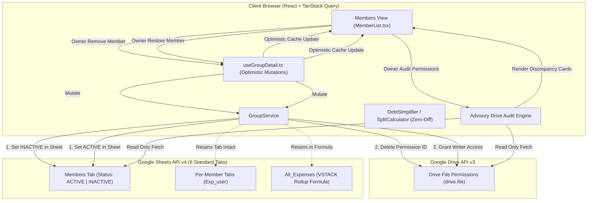

# Member Soft-Deletion & Drive Permission Audit

*   **Author:** Spread-Spends Engineering
*   **Status:** Approved
*   **Date:** 2026-10-24
*   **Task Directory:** `docs/designs/member-soft-delete-sync/`

---

## Overview

Spread-Spends is a decentralized, client-side expense sharing Progressive Web App that uses Google Sheets spreadsheets as distributed databases and Google Drive permissions for access control. This design introduces owner-managed member soft-deletion, Google Drive permission revocation, ledger protection rules, 1-click member restoration, and an on-demand, advisory Google Drive permission audit in the Members view.

---

## The Problem

Currently, Spread-Spends lacks an integrated mechanism for managing departing group members or reconciling out-of-band access changes made directly in Google Drive:
1. **Accidental Ledger Corruption**: If a user leaves a group or is removed, deleting their record or tab breaks `=IFERROR(SORT(VSTACK(...)))` formulas in `All_Expenses` and destroys historical audit trails.
2. **Access Control Desynchronization**: Group membership recorded in the `Members` tab can diverge from Google Drive file permissions if permissions are modified directly in the Google Drive UI. There is no audit tool to detect or fix untracked Drive editors or active members who lost access.
3. **Historical Distortion Risks**: Editing or deleting past transactions involving former group members can silently distort finalized debt calculations without explicit user confirmation.

---

## Goals

*   Allow group owners to soft-delete members, marking their status as `INACTIVE` in the `Members` tab and revoking their Google Drive `writer` permissions.
*   Preserve historical data integrity by retaining removed members' `Exp_<email>` tabs and maintaining their tab references in the master `All_Expenses` `VSTACK` formula.
*   Retain inactive members in debt simplification and balance calculations so pre-existing debts can be settled.
*   Filter out inactive members from the member selector when creating new expenses, while retaining them in edit mode for historical expenses they participated in.
*   Display visual indicators for removed members: grayscale avatars (`filter: grayscale(100%) opacity-60`) and a `(Removed)` badge next to their names across transaction and balance lists.
*   Enforce a confirmation warning whenever any member attempts to edit or delete a transaction involving a soft-deleted member.
*   Provide a 1-click member restoration flow for group owners (`restoreMember`), re-granting Drive `writer` permissions and reactivating their `Exp_<email>` tab. Allow non-owners to propose restoring an inactive member using the existing `Pending_Invites` system without adding new spreadsheet tabs.
*   Provide an owner-only "Audit Drive Permissions" button in the Members view that performs an on-demand, read-only comparison of Google Drive sharing permissions against the `Members` tab, displaying detected discrepancies with explicit 1-click remediation actions.
*   Maintain all member management UI cleanly within the existing `src/pages/group/members/MemberList.tsx` component.

---

## Non-Goals

*   Hard-deleting member records, personal worksheet tabs, or historical transactions from Google Sheets.
*   Autonomous or background 2-way synchronization between Google Drive and Google Sheets (the audit is strictly on-demand, read-only, and requires explicit owner confirmation for any remediation).
*   Creating additional worksheet tabs in Google Sheets (e.g. no `Restore_Requests` tab; existing 6 tabs are preserved).
*   Automatic bulk mutation of Google Sheets or Drive permissions without explicit user action.

---

## Open Questions

None. All architectural questions resolved.

---

## Critical User Journeys (CUJs)

### CUJ 1: Owner Soft-Deletes an Active Member
*   **Given**: An active group member ("Bob") with existing expense records on `Exp_bob@example.com` and an active debt balance.
*   **When**: The group owner navigates to Members and clicks "Remove" next to Bob.
*   **Then**: 
    1. Bob's status in the `Members` sheet is updated to `INACTIVE`.
    2. Bob's Google Drive `writer` permission is deleted via Google Drive API.
    3. Bob's personal tab `Exp_bob@example.com` remains intact in the spreadsheet and stays in the `All_Expenses` formula.
    4. Bob moves to the Inactive Members sub-list with a grayscale avatar.
    5. Bob can no longer be selected in the Add Expense modal for new expenses, but Bob's debts remain visible in Balances.

### CUJ 2: Member Edits a Transaction Involving an Inactive Member
*   **Given**: An existing expense ("Dinner") paid by Alice, where Bob (now marked `INACTIVE`) is one of the split participants.
*   **When**: Alice or any member opens the transaction in `TransactionHistoryModal` and clicks "Edit" or "Delete".
*   **Then**: 
    1. An inline warning banner appears: "⚠️ Historical Record Notice: This transaction involves a departed member. Altering or deleting it will recalculate historical balances."
    2. In edit mode within `AddExpenseModal`, Bob is retained as an available participant because Bob was an original participant in this transaction.
    3. Saving the edit recalculates splits and preserves audit history.

### CUJ 3: Owner Restores an Inactive Member
*   **Given**: Bob is listed under Inactive Members.
*   **When**: The group owner clicks "Restore" next to Bob's name.
*   **Then**: 
    1. Bob's status in `Members` is set back to `ACTIVE`.
    2. Bob is re-granted Google Drive `writer` permission via Drive API.
    3. Bob returns to the Active Members list and can once again be selected for new expenses.

### CUJ 4: Owner Audits Drive Permissions
*   **Given**: An external user ("Eve") was granted editor access directly in Google Drive without being added to the app, and Bob (marked `INACTIVE` in sheet) still holds Drive write access due to a past offline sync failure.
*   **When**: The owner clicks "Audit Drive Permissions" in the Members view.
*   **Then**: 
    1. The app queries `drive.permissions.list` and compares it against the `Members` tab.
    2. Eve is flagged as an advisory discrepancy (`DRIVE_USER_NOT_IN_SHEET`) with buttons to "Add to Group" or "Revoke Access".
    3. Bob is flagged as (`INACTIVE_HAS_WRITE_ACCESS`) with buttons to "Revoke Access" or "Restore Member".
    4. Zero automatic mutations occur until the owner explicitly clicks a remediation button.

---

## Technical Plan (Architecture)

### 1. Architectural Model & Zero-Backend Invariants

Spread-Spends operates with zero backend servers. All state persists across Google Drive v3 permissions and Google Sheets v4 worksheets:



### 2. Google Drive Permissions Service Layer (`src/services/googleDrive.ts`)

The Google Drive service is expanded with two focused methods under the `drive.file` scope:

*   **`getFilePermissions(token, fileId)`**:
    Queries `permissions(id, emailAddress, role, type, photoLink, displayName)`. Filters to user permissions (`type === 'user'`).
*   **`removePermission(token, fileId, permissionId)`**:
    Executes HTTP `DELETE https://www.googleapis.com/drive/v3/files/${fileId}/permissions/${permissionId}`. Handles HTTP 404 idempotently (treated as successful revocation).
*   **Error Tolerance**: In `softDeleteMember`, permission revocation is executed as a best-effort call. If Drive revocation fails (e.g. rate limit), the sheet mutation completes, and the discrepancy is surfaced in the next advisory audit for 1-click retry.

### 3. Data Schemas & Spreadsheet Serialization (`src/core/sheetSerializer.ts`)

*   **Zero New Tabs**: No `Restore_Requests` tab is created. The spreadsheet preserves its standard 6 tabs.
*   **`Members` Tab**:
    Uses existing columns `['Email', 'Display Name', 'Role', 'Status', 'Added By', 'Joined At', 'Picture']`. `Status` stores `'ACTIVE'` | `'INACTIVE'`.
*   **`All_Expenses` Rollup Formula**:
    `generateAllExpensesFormula(memberEmails: string[])` remains **ZERO-DIFF**. Callers pass all members with confirmed personal tabs in sheet metadata (`group.members.map(m => m.email)`), ensuring tabs for inactive members are never dropped from `=IFERROR(SORT(VSTACK(...)))`.

### 4. Financial Calculations & Split Integrity (`src/core/debtSimplifier.ts`)

*   **`calculateBalances` and `simplifyDebts`**:
    Remain **ZERO-DIFF**. Both functions are already status-agnostic and operate on arrays of transaction records and members. Inactive members who have non-zero net balances retain their balance cards and can settle debts.
*   **`AddExpenseModal` Participant Filtering**:
    When creating a *new* expense, candidates are filtered to `m.status === 'ACTIVE'`. When *editing* an existing expense, candidates include active members plus any inactive member who was an original participant:
    ```typescript
    members.filter(m => m.status === 'ACTIVE' || isExistingExpenseParticipant(m.email))
    ```
*   **`SettleUpModal`**:
    Permits selecting inactive members who hold an active simplified debt or net balance, enabling complete financial settlement.

### 5. Advisory Drive Permission Audit Matrix

The audit is strictly on-demand, read-only, and requires explicit owner interaction for any remediation:

| Discovered State | Drive Permission | Sheet `Members` Status | Discrepancy Type | Owner Remediation Actions |
|---|---|---|---|---|
| **Missing Drive Access** | None | `ACTIVE` | `MISSING_DRIVE_PERMISSION` | **[Grant Writer Access]** or **[Remove Member]** |
| **Inactive Retains Write Access** | `writer` / `owner` | `INACTIVE` | `INACTIVE_HAS_WRITE_ACCESS` | **[Revoke Access]** or **[Restore Member]** |
| **Drive Editor Not in Sheet** | `writer` | Missing | `DRIVE_USER_NOT_IN_SHEET` | **[Add to Group]** or **[Revoke Access]** |
| **View-Only Access** | `reader` | Any | `READ_ONLY_ACCESS` | **[Upgrade to Writer]** or **[Revoke Access]** |

Zero automatic mutations occur during audit; each discrepancy card offers discrete 1-click owner actions.

### 6. User Interface Architecture (`src/pages/group/members/MemberList.tsx`)

Member management remains unified inside `src/pages/group/members/MemberList.tsx`:
1.  **Active Members List**: Renders active contributors with owner badges. Owners see a "Remove" button next to non-owner members.
2.  **Inactive Members Section**: Displayed below active members when `members.some(m => m.status === 'INACTIVE')`. Renders grayscale avatars, `(Removed)` badge, and an owner "Restore" button. Non-owners see a "Request Restore" button that pre-fills the standard invite dialog.
3.  **Audit Permissions Dialog**: Launched from an "Audit Drive Permissions" button in the `MemberList` header. Fetches permissions on-demand and renders discrepancy cards with 1-click action buttons.
4.  **Transaction History Warning**: Inline warning banner in `TransactionHistoryModal` rendered when a transaction involves an inactive member.

---

## Alternatives Considered

### Alternative A: Hard Deletion of Member Rows and Tabs [REJECTED]

*   **Status**: REJECTED
*   **Pros**: Keeps the spreadsheet compact and reduces range count over time.
*   **Cons**: Breaks `=IFERROR(SORT(VSTACK(...)))` in `All_Expenses` (causing `#REF!` errors in Google Sheets), deletes historical transaction ledgers, makes penny conservation auditing impossible, and prevents settling outstanding debts.
*   **Reason for Rejection**: Violates the core system invariant of immutable audit trails and decentralized penny conservation.

### Alternative B: Automated Background Drive Polling on Page Navigation [REJECTED]

*   **Status**: REJECTED
*   **Pros**: Detects permission drift automatically without requiring the owner to manually click audit.
*   **Cons**: Triggers Google Drive API calls on every route navigation and app load, rapidly exhausting Google Cloud per-user quotas (20,000 requests/100 seconds), increasing network latency, and draining mobile battery.
*   **Reason for Rejection**: Excessive API overhead and quota risks. On-demand owner audit aligns with the client-side, zero-backend architecture.

### Alternative C: Overloading `Pending_Invites` Tab for Restore Petitions [REJECTED]

*   **Status**: REJECTED
*   **Pros**: Avoids creating a new `Restore_Requests` worksheet tab in the spreadsheet.
*   **Cons**: Merges distinct schemas (onboarding an external user vs. tracking multi-member endorsements for a soft-deleted peer) into a single polymorphic table, complicating deserialization and breaking legacy invite parsers.
*   **Reason for Rejection**: Stage 8 Intermediate Zoom-Out eliminated collaborative multi-party endorsement voting entirely; 1-click owner restore makes custom petition tables obsolete.

### Alternative D: Unilaterally Revoking Drive Permissions to Match Spreadsheet State [REJECTED]

*   **Status**: REJECTED
*   **Pros**: Forces Google Drive permissions to always match local spreadsheet records.
*   **Cons**: Modifying or revoking a user's Google Drive permission without the owner's explicit review can inadvertently lock collaborators out if the spreadsheet had an outdated offline cache or if the owner intentionally invited them via Drive.
*   **Reason for Rejection**: Google Drive permissions are the absolute source of truth for access rights. Synchronization must be an advisory audit with explicit user consent, not autonomous mutation.

---

## Non-Functional Requirements

### Security & Privacy
*   All operations execute strictly within the user's browser using the least-privilege `drive.file` scope. No backend servers or third-party proxies receive auth tokens or user email lists.
*   Member removal and permission revocations require explicit owner confirmation.

### Performance & Latency
*   Audit queries use selective field masks (`fields=permissions(id, emailAddress, role, type, displayName, photoLink)`) in a single HTTP `GET`, completing in under 200ms.
*   Spreadsheet reads preserve existing single-roundtrip `batchGet` efficiency.

### Rollout & Compatibility
*   100% backward compatible with existing Spread-Spends sheets: zero schema modifications or new tabs are required. Existing groups instantly support soft-deleting and restoring members.

---

## Detailed Implementation Plan (Normalized 10-File Plan)

### Target Files to Create/Modify

#### 1. `src/types/group.ts` (Modify)
*   **Type / Scope**: TypeScript Domain Interfaces
*   **Proposed Changes**:
    *   Add advisory Drive discrepancy types (`Member` and `MemberStatus` already exist):
        ```typescript
        export type DriveDiscrepancyType =
          | 'MISSING_DRIVE_PERMISSION'
          | 'INACTIVE_HAS_WRITE_ACCESS'
          | 'DRIVE_USER_NOT_IN_SHEET'
          | 'READ_ONLY_ACCESS';

        export interface DriveDiscrepancy {
          email: string;
          name?: string;
          type: DriveDiscrepancyType;
          permissionId?: string;
        }
        ```

#### 2. `src/services/googleDrive.ts` (Modify)
*   **Type / Scope**: Google Drive REST Client Service
*   **Proposed Changes**:
    *   Expand `getFilePermissions` query to include `id, role, type, displayName, photoLink` and filter `type === 'user'`.
    *   Implement `removePermission(token: string, fileId: string, permissionId: string): Promise<void>` via HTTP `DELETE https://www.googleapis.com/drive/v3/files/${fileId}/permissions/${permissionId}`, handling HTTP 404 idempotently.

#### 3. `src/services/groupService.ts` (Modify)
*   **Type / Scope**: Application Group Business Service
*   **Proposed Changes**:
    *   Add `softDeleteMember(sheetId: string, memberEmail: string): Promise<void>`:
        *   Verifies member exists and is not `OWNER`.
        *   Sets `target.status = 'INACTIVE'` and saves via `updateSheetRange`.
        *   Queries `getFilePermissions` to match `emailAddress` and executes `removePermission`.
    *   Add `restoreMember(sheetId: string, memberEmail: string): Promise<void>`:
        *   Sets `target.status = 'ACTIVE'` and saves via `updateSheetRange`.
        *   Calls `googleDriveService.grantPermission(token, sheetId, memberEmail, 'writer')`.
    *   Add `auditDrivePermissions(sheetId: string): Promise<DriveDiscrepancy[]>`:
        *   Compares `Members` tab against `getFilePermissions` and returns discrepancy list.

#### 4. `src/services/mockGoogleService.ts` (Modify)
*   **Type / Scope**: Mock Service & Test Harness
*   **Proposed Changes**:
    *   Implement in-memory mock methods: `softDeleteMember`, `restoreMember`, and `auditDrivePermissions`.
    *   Update mock group data with active and inactive member fixtures.

#### 5. `src/hooks/useGroupDetail.ts` (Modify)
*   **Type / Scope**: Central State Management & TanStack Query Hook
*   **Proposed Changes**:
    *   Add `softDeleteMemberMutation`: Optimistically sets `member.status = 'INACTIVE'` in query cache, calls `groupService.softDeleteMember`, and invalidates queries on settle.
    *   Add `restoreMemberMutation`: Optimistically sets `member.status = 'ACTIVE'` in query cache, calls `groupService.restoreMember`, and invalidates queries on settle.
    *   Expose `softDeleteMember`, `isSoftDeletingMember`, `restoreMember`, and `isRestoringMember` in hook return payload.

#### 6. `src/pages/group/GroupContext.tsx` (Modify)
*   **Type / Scope**: Group Context Provider & Types
*   **Proposed Changes**:
    *   Add `softDeleteMember` and `restoreMember` mutation functions and pending flags to `GroupContextValue` interface.
    *   Forward functions from `useGroupDetail` through `GroupContextProvider`.

#### 7. `src/components/common/UserAvatar.tsx` (Modify)
*   **Type / Scope**: UI Atom Component
*   **Proposed Changes**:
    *   Add optional `isInactive?: boolean` prop. When true, applies `grayscale opacity-60` to avatar image or initial fallback container.

#### 8. `src/pages/group/members/MemberList.tsx` (Modify)
*   **Type / Scope**: Member Management View Component
*   **Proposed Changes**:
    *   Partition member list into Active Members (`m.status === 'ACTIVE'`) and Inactive Members (`m.status === 'INACTIVE'`).
    *   Add "Remove" button on active member rows for group owner (triggers confirmation alert).
    *   Render Inactive Members sub-list with grayscale avatars and `(Removed)` badge.
    *   Render "Restore" button for group owner on inactive rows (calls `restoreMember`).
    *   Render "Request Restore" button for non-owners (opens invite dialog pre-filled with email).
    *   Add "Audit Drive Permissions" button in header for group owner, rendering discrepancy cards with 1-click action buttons ("Grant Access", "Revoke Access", "Add to Group").

#### 9. `src/pages/group/expenses/AddExpenseModal.tsx` (Modify)
*   **Type / Scope**: Transaction Creation Modal
*   **Proposed Changes**:
    *   In Step 1 (`paidBy`) and Step 2 (`splits`), filter participant selection:
        ```typescript
        members.filter(m => m.status === 'ACTIVE' || isExistingExpenseParticipant(m.email))
        ```
    *   Prevents adding inactive members to new expenses while preserving them when editing historical expenses.

#### 10. `src/pages/group/expenses/TransactionHistoryModal.tsx` (Modify)
*   **Type / Scope**: Transaction Audit & Action Modal
*   **Proposed Changes**:
    *   Check whether transaction includes any inactive participant in `paidBy` or `splits`.
    *   If true, render an inline warning banner above the Action buttons:
        `⚠️ Historical Record Notice: This transaction involves a departed member. Altering or deleting it will recalculate historical balances.`

#### 11. `src/test/groupService.test.ts` (Modify)
*   **Type / Scope**: Unit & Integration Test Suite
*   **Proposed Changes**:
    *   Add unit test for `softDeleteMember` (verifying sheet status update and Drive permission deletion).
    *   Add unit test for `restoreMember` (verifying status reactivation and Drive permission grant).
    *   Add unit test for `auditDrivePermissions` (verifying discrepancy detection across missing permissions and inactive writers).

---

## Verification Plan

*   **Compilation / Build**:
    ```bash
    bun run build
    ```
    Guarantees TypeScript types, interfaces, and JSX components compile cleanly with zero errors.

*   **Automated Unit & Integration Test Suite**:
    ```bash
    bun test
    bun test src/test/groupService.test.ts
    ```
    Validates 100% test pass rate across group mutations and calculation integrity.

*   **Static Analysis & Linting**:
    ```bash
    bunx oxlint
    ```
    Validates code health and conformance with project linting rules.

---

*Drafted and Validated with EGM*
